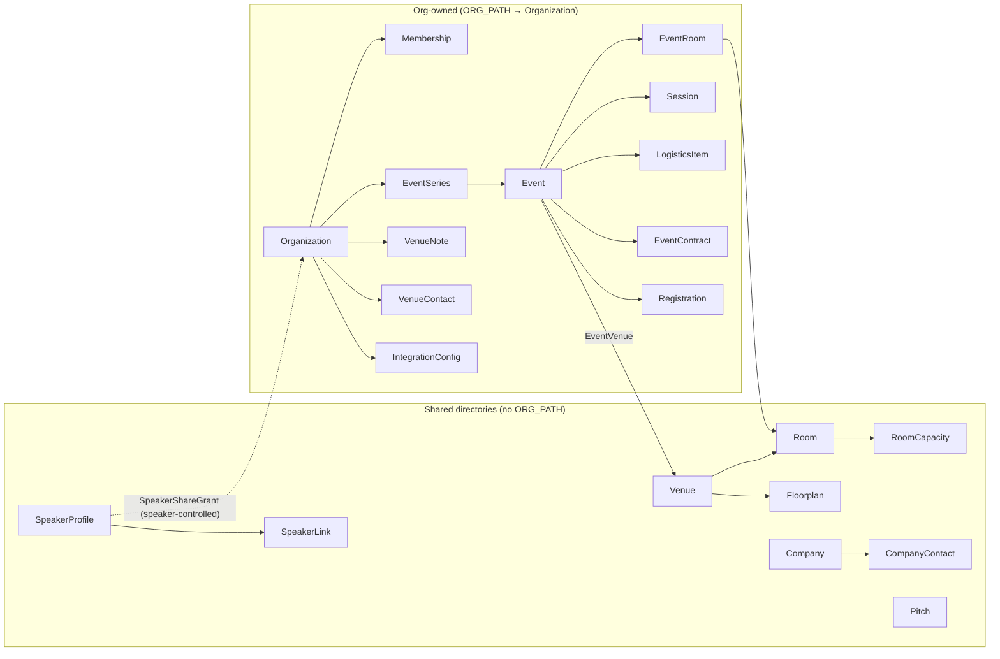
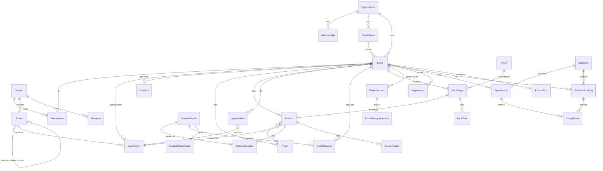

# Architecture

## Tenancy and sharing

- **Org-owned models** declare `ORG_PATH` (e.g. `Session.ORG_PATH = "event__organization"`).
  `OrgScopedQuerySet` provides `for_user(user, min_role)`, `for_organization(org)`,
  `visible_to_organization(org)` (own rows + NETWORK/PUBLIC shared rows) and `public()`.
  `core.models.resolve_organization(obj)` walks the path for permission checks.
- **Roles** (`organizations.Membership.Role`): VIEWER (read), STAFF (edit), ADMIN
  (org settings, memberships, integrations). `organizations.permissions` holds the only
  role-check helpers; admin (`core.admin`) and API (`api.base`) both use them.
  Superusers bypass scoping.
- **`Visibility`** (PRIVATE / NETWORK / PUBLIC) exists on shareable rows: events and
  series (cross-org calendar), venue notes/contacts. `EventContract`, `RoomPickupSnapshot`,
  `Registration`, `EventSpeaker`, sponsorship amounts and invoices have **no** visibility
  field and are never exported.
- **Speaker privacy**: `SpeakerProfile.PUBLIC_FIELDS` are visible to all;
  `PRIVATE_FIELDS` (email, phone, city/region/country) only to orgs with an active
  `SpeakerShareGrant`, or to the speaker. Policy lives in `speakers/sharing.py`.

## Model map

### Notable modeling choices

- **EventRoom** is a venue room *as configured for one event*: grid column order, setup,
  capacity override, lab OS, recording default, public visibility. Sessions and logistics
  items are placed in EventRooms, so the physical room stays shared.
- **Combined rooms**: a Room with `parts` (e.g. "White River E-F" = E + F). `Room.atoms()` /
  `program.conflicts.atoms_for_event_rooms()` expand rooms to indivisible parts; two
  bookings conflict when their atoms intersect.
- **TimeSlot** rows are per day and only guide the grid; sessions hold real start/end
  datetimes.
- **Session.public_id** is a per-event number (starting at `Organization.session_id_start`)
  used in feed IDs, ICS UIDs and attendee favorites. Never reused, never edited.
- **Session readiness** (`is_ready`, `SessionQuerySet.ready()`): placed + timed + title
  `EDITED` + not canceled. Description has its own edit status but doesn't gate publishing.
- **RoomUsage** (abstract) gives Session and LogisticsItem the same hotel-order fields
  (setup, headcount, A/V, F&B, notes), so a hotel spec sheet can be generated from both.
- **LogisticsItem.blocks_room** (or its category default): registration desks block a room;
  water service and catering share one with sessions.
- **EventContract** stores the four F&B minimums (overall/affiliate × with/without service
  and tax), AV cost, attendee room rate and room-block total; `RoomPickupSnapshot` is the
  pickup time series. The contract PDF uses the `private` storage (signed URLs on S3).
- **Pitch → PitchTarget**: a pitch is written once and submitted to several events, possibly
  run by different orgs; each target has its own status, answers, votes and resulting session.
- **Sponsorship scope**: EVENT / TRACK / SESSION / SPECIAL_EVENT (a session such as a banquet),
  validated in `clean()`. Comp tickets are counted against `ticket_entitlement`.
- **ExternalIdentity** (generic FK) links any row to an outside system's ID per org and
  connector, e.g. an Event to its MemberSuite event, so connectors upsert idempotently.

## Data flows

**Scheduling** — every grid move goes through `program.scheduling.place_session()` /
`place_logistics_item()`: lock the event row (`SELECT … FOR UPDATE`), run
`program.conflicts.check_*()` against the proposed placement, save only if there are no
ERROR conflicts, and return errors and warnings either way. Model `clean()` runs the same
checks for admin and API saves. `event_conflicts(event)` sweeps the whole event for the grid.

**Pitches** — `pitches.services`: `submit_pitch` (checks the pitch window, validates custom
answers, grants sharing) → `queue_decision` (ACCEPT_QUEUE / DECLINE_QUEUE / WAITLISTED) →
`inform` (finalizes the decision, creates sessions via `accept`, stamps `informed_at`, calls
the notifier hook) → `confirm`. `merge` folds pitches together, and their speakers join the
resulting session.

**Publishing** — `publishing.bundle.build_event_bundle(event, Audience.PUBLIC)` → validate
against `schemas/event-bundle/v1.json` → each exporter renders files from the bundle dict
→ the storage connector (`s3` if enabled for the org, else `local`) writes them under
`path_template` (default `{org}/{event}/`) → `PublishRun` records paths, URLs and hashes. A
failing exporter marks the run PARTIAL without blocking the others. `/feeds/…` serves the same
content live.

**Import** — `publishing.importer.import_bundle(bundle, org)` validates the bundle, then
upserts by stable keys (event slug, session public id, speaker public id or email, room name,
track slug). Existing global profiles only get blank fields filled. Conflicts are reported,
not enforced, because historical data may contain them.

**Integrations** — `integrations.services.context_for(org, slug, event)` merges org- and
event-scoped credentials (decrypted) into a `ConnectorContext`; connectors return normalized
dataclasses (`RegistrationRecord`, `MemberRecord`, ...), and services upsert them, logging a
`SyncRun`.

**Background work** — Django Tasks (`@task`, `.enqueue()`); `publishing.tasks`,
`integrations.tasks`. Run `manage.py db_worker`. Tests use the ImmediateBackend.
